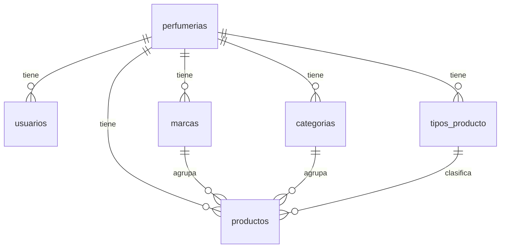

# Modelo de datos

Modelo relacional del MVP (MySQL 8). Las decisiones que lo justifican están en docs/decisiones.md (D-006 a D-009, D-013 a D-015).

## Diagrama



- Toda tabla salvo `perfumerias` tiene `perfumeria_id` (regla multi-tenant).
- El género es un enum, no una tabla (D-008). No hay tabla de roles: un solo rol en el MVP.

## Convenciones (D-015)
- PK `id BIGINT AUTO_INCREMENT` en todas las tablas.
- `creado_en` y `actualizado_en` (`DATETIME`, con default de la base para que los scripts de carga no tengan que completarlos).
- InnoDB, `utf8mb4`, collation `utf8mb4_0900_ai_ci`: búsquedas y unicidad sin distinguir tildes ni mayúsculas.
- Enums como `VARCHAR` + `CHECK`, mapeados en JPA con `@Enumerated(EnumType.STRING)`.
- Dinero en `DECIMAL(12,2)`.
- Todas las FK con `ON DELETE RESTRICT`.
- Nombres de restricciones: `pk_`, `fk_`, `uk_`, `ck_`, `idx_`.

## Tablas

### perfumerias
| Columna | Tipo | Restricciones |
|---|---|---|
| id | BIGINT | PK |
| slug | VARCHAR(60) | NOT NULL, UNIQUE |
| nombre | VARCHAR(100) | NOT NULL |
| descripcion | VARCHAR(1000) | |
| logo_url | VARCHAR(500) | |
| logo_id | VARCHAR(255) | identificador en Cloudinary (D-003) |
| color_principal | CHAR(7) | formato `#RRGGBB` (validado en la app) |
| whatsapp | VARCHAR(20) | solo dígitos con código de país, ej. `5491122334455` |
| instagram | VARCHAR(50) | solo el usuario, sin `@` ni URL |
| direccion | VARCHAR(255) | |
| email_contacto | VARCHAR(150) | |
| comportamiento_sin_stock | VARCHAR(20) | NOT NULL, default `DESHABILITAR_BOTON`, CHECK (`DESHABILITAR_BOTON`, `MOSTRAR_BOTON`) |
| seo_titulo | VARCHAR(70) | si es NULL se usa el nombre |
| seo_descripcion | VARCHAR(160) | si es NULL se usa la descripción |
| activa | BOOLEAN | NOT NULL, default TRUE |

`comportamiento_sin_stock`:
- `DESHABILITAR_BOTON` (default): el botón de WhatsApp se muestra deshabilitado junto a "Sin stock". Las consultas se concentran en productos que se pueden vender.
- `MOSTRAR_BOTON`: el botón sigue activo y el mensaje pregunta por la reposición.

### usuarios
| Columna | Tipo | Restricciones |
|---|---|---|
| id | BIGINT | PK |
| perfumeria_id | BIGINT | NOT NULL, FK → perfumerias |
| email | VARCHAR(150) | NOT NULL, UNIQUE global (el login no recibe slug) |
| password_hash | VARCHAR(100) | NOT NULL, BCrypt |
| nombre | VARCHAR(100) | NOT NULL |
| rol | VARCHAR(20) | NOT NULL, default `ADMIN`, CHECK (`ADMIN`) |
| activo | BOOLEAN | NOT NULL, default TRUE |

### marcas
| Columna | Tipo | Restricciones |
|---|---|---|
| id | BIGINT | PK |
| perfumeria_id | BIGINT | NOT NULL, FK → perfumerias |
| nombre | VARCHAR(80) | NOT NULL, UNIQUE (perfumeria_id, nombre) |

### categorias
| Columna | Tipo | Restricciones |
|---|---|---|
| id | BIGINT | PK |
| perfumeria_id | BIGINT | NOT NULL, FK → perfumerias |
| nombre | VARCHAR(80) | NOT NULL, UNIQUE (perfumeria_id, nombre) |
| slug | VARCHAR(90) | NOT NULL, UNIQUE (perfumeria_id, slug) |
| descripcion | VARCHAR(500) | texto para la meta description de la página de categoría |

### tipos_producto
| Columna | Tipo | Restricciones |
|---|---|---|
| id | BIGINT | PK |
| perfumeria_id | BIGINT | NOT NULL, FK → perfumerias |
| nombre | VARCHAR(50) | NOT NULL, UNIQUE (perfumeria_id, nombre) |

### productos
| Columna | Tipo | Restricciones |
|---|---|---|
| id | BIGINT | PK |
| perfumeria_id | BIGINT | NOT NULL, FK → perfumerias |
| marca_id | BIGINT | NOT NULL, FK → marcas |
| categoria_id | BIGINT | NOT NULL, FK → categorias |
| tipo_producto_id | BIGINT | NOT NULL, FK → tipos_producto |
| nombre | VARCHAR(150) | NOT NULL |
| slug | VARCHAR(180) | NOT NULL, UNIQUE (perfumeria_id, slug) |
| genero | VARCHAR(10) | NOT NULL, CHECK (`HOMBRE`, `MUJER`, `UNISEX`) |
| mililitros | SMALLINT UNSIGNED | NOT NULL, CHECK > 0 |
| precio | DECIMAL(12,2) | NOT NULL, CHECK >= 0 |
| descripcion | VARCHAR(2000) | |
| notas_salida | VARCHAR(255) | texto libre |
| notas_corazon | VARCHAR(255) | texto libre |
| notas_fondo | VARCHAR(255) | texto libre |
| imagen_url | VARCHAR(500) | |
| imagen_id | VARCHAR(255) | identificador en Cloudinary (D-003) |
| disponible | BOOLEAN | NOT NULL, default TRUE (D-006) |
| activo | BOOLEAN | NOT NULL, default TRUE |

Índice `idx_productos_listado (perfumeria_id, activo, categoria_id)` para el listado público. No se agregan más índices hasta medir que hagan falta.

## Reglas que se validan en la aplicación
La base no puede garantizar todo; estas reglas viven en los services (con tests) y en Bean Validation:
- **Aislamiento de relaciones (D-013)**: al crear o editar un producto, marca, categoría y tipo se buscan con `findByIdAndPerfumeriaId`. Si no pertenecen a la perfumería del usuario → 404.
- **Slugs (D-014)**: generados por el backend, únicos por perfumería, fijos después de crearse. Slugs de perfumería reservados: `admin`, `api`.
- **Formatos**: `color_principal` (`#RRGGBB`), `whatsapp` (solo dígitos), emails válidos, longitudes máximas iguales a las de la tabla.
- **Eliminación (D-009)**: marca, categoría o tipo con productos → 409 antes de llegar al `RESTRICT` de la base.

## SQL inicial
Será la migración `V1__esquema_inicial.sql` de Flyway en la Etapa 4. Las 2 perfumerías de la demo, sus usuarios y sus categorías y tipos iniciales (Perfumes, Decants, Body Splash / EDP, EDT, Extrait de parfum, Body Splash, Decant) van en una migración aparte (D-010).

```sql
CREATE TABLE perfumerias (
    id                       BIGINT        NOT NULL AUTO_INCREMENT,
    slug                     VARCHAR(60)   NOT NULL,
    nombre                   VARCHAR(100)  NOT NULL,
    descripcion              VARCHAR(1000) NULL,
    logo_url                 VARCHAR(500)  NULL,
    logo_id                  VARCHAR(255)  NULL,
    color_principal          CHAR(7)       NULL,
    whatsapp                 VARCHAR(20)   NULL,
    instagram                VARCHAR(50)   NULL,
    direccion                VARCHAR(255)  NULL,
    email_contacto           VARCHAR(150)  NULL,
    comportamiento_sin_stock VARCHAR(20)   NOT NULL DEFAULT 'DESHABILITAR_BOTON',
    seo_titulo               VARCHAR(70)   NULL,
    seo_descripcion          VARCHAR(160)  NULL,
    activa                   BOOLEAN       NOT NULL DEFAULT TRUE,
    creado_en                DATETIME      NOT NULL DEFAULT CURRENT_TIMESTAMP,
    actualizado_en           DATETIME      NOT NULL DEFAULT CURRENT_TIMESTAMP ON UPDATE CURRENT_TIMESTAMP,
    CONSTRAINT pk_perfumerias PRIMARY KEY (id),
    CONSTRAINT uk_perfumerias_slug UNIQUE (slug),
    CONSTRAINT ck_perfumerias_sin_stock CHECK (comportamiento_sin_stock IN ('DESHABILITAR_BOTON', 'MOSTRAR_BOTON'))
) ENGINE = InnoDB DEFAULT CHARSET = utf8mb4 COLLATE = utf8mb4_0900_ai_ci;

CREATE TABLE usuarios (
    id             BIGINT       NOT NULL AUTO_INCREMENT,
    perfumeria_id  BIGINT       NOT NULL,
    email          VARCHAR(150) NOT NULL,
    password_hash  VARCHAR(100) NOT NULL,
    nombre         VARCHAR(100) NOT NULL,
    rol            VARCHAR(20)  NOT NULL DEFAULT 'ADMIN',
    activo         BOOLEAN      NOT NULL DEFAULT TRUE,
    creado_en      DATETIME     NOT NULL DEFAULT CURRENT_TIMESTAMP,
    actualizado_en DATETIME     NOT NULL DEFAULT CURRENT_TIMESTAMP ON UPDATE CURRENT_TIMESTAMP,
    CONSTRAINT pk_usuarios PRIMARY KEY (id),
    CONSTRAINT uk_usuarios_email UNIQUE (email),
    CONSTRAINT fk_usuarios_perfumeria FOREIGN KEY (perfumeria_id) REFERENCES perfumerias (id) ON DELETE RESTRICT,
    CONSTRAINT ck_usuarios_rol CHECK (rol IN ('ADMIN'))
) ENGINE = InnoDB DEFAULT CHARSET = utf8mb4 COLLATE = utf8mb4_0900_ai_ci;

CREATE TABLE marcas (
    id             BIGINT      NOT NULL AUTO_INCREMENT,
    perfumeria_id  BIGINT      NOT NULL,
    nombre         VARCHAR(80) NOT NULL,
    creado_en      DATETIME    NOT NULL DEFAULT CURRENT_TIMESTAMP,
    actualizado_en DATETIME    NOT NULL DEFAULT CURRENT_TIMESTAMP ON UPDATE CURRENT_TIMESTAMP,
    CONSTRAINT pk_marcas PRIMARY KEY (id),
    CONSTRAINT uk_marcas_perfumeria_nombre UNIQUE (perfumeria_id, nombre),
    CONSTRAINT fk_marcas_perfumeria FOREIGN KEY (perfumeria_id) REFERENCES perfumerias (id) ON DELETE RESTRICT
) ENGINE = InnoDB DEFAULT CHARSET = utf8mb4 COLLATE = utf8mb4_0900_ai_ci;

CREATE TABLE categorias (
    id             BIGINT       NOT NULL AUTO_INCREMENT,
    perfumeria_id  BIGINT       NOT NULL,
    nombre         VARCHAR(80)  NOT NULL,
    slug           VARCHAR(90)  NOT NULL,
    descripcion    VARCHAR(500) NULL,
    creado_en      DATETIME     NOT NULL DEFAULT CURRENT_TIMESTAMP,
    actualizado_en DATETIME     NOT NULL DEFAULT CURRENT_TIMESTAMP ON UPDATE CURRENT_TIMESTAMP,
    CONSTRAINT pk_categorias PRIMARY KEY (id),
    CONSTRAINT uk_categorias_perfumeria_nombre UNIQUE (perfumeria_id, nombre),
    CONSTRAINT uk_categorias_perfumeria_slug UNIQUE (perfumeria_id, slug),
    CONSTRAINT fk_categorias_perfumeria FOREIGN KEY (perfumeria_id) REFERENCES perfumerias (id) ON DELETE RESTRICT
) ENGINE = InnoDB DEFAULT CHARSET = utf8mb4 COLLATE = utf8mb4_0900_ai_ci;

CREATE TABLE tipos_producto (
    id             BIGINT      NOT NULL AUTO_INCREMENT,
    perfumeria_id  BIGINT      NOT NULL,
    nombre         VARCHAR(50) NOT NULL,
    creado_en      DATETIME    NOT NULL DEFAULT CURRENT_TIMESTAMP,
    actualizado_en DATETIME    NOT NULL DEFAULT CURRENT_TIMESTAMP ON UPDATE CURRENT_TIMESTAMP,
    CONSTRAINT pk_tipos_producto PRIMARY KEY (id),
    CONSTRAINT uk_tipos_producto_perfumeria_nombre UNIQUE (perfumeria_id, nombre),
    CONSTRAINT fk_tipos_producto_perfumeria FOREIGN KEY (perfumeria_id) REFERENCES perfumerias (id) ON DELETE RESTRICT
) ENGINE = InnoDB DEFAULT CHARSET = utf8mb4 COLLATE = utf8mb4_0900_ai_ci;

CREATE TABLE productos (
    id               BIGINT            NOT NULL AUTO_INCREMENT,
    perfumeria_id    BIGINT            NOT NULL,
    marca_id         BIGINT            NOT NULL,
    categoria_id     BIGINT            NOT NULL,
    tipo_producto_id BIGINT            NOT NULL,
    nombre           VARCHAR(150)      NOT NULL,
    slug             VARCHAR(180)      NOT NULL,
    genero           VARCHAR(10)       NOT NULL,
    mililitros       SMALLINT UNSIGNED NOT NULL,
    precio           DECIMAL(12, 2)    NOT NULL,
    descripcion      VARCHAR(2000)     NULL,
    notas_salida     VARCHAR(255)      NULL,
    notas_corazon    VARCHAR(255)      NULL,
    notas_fondo      VARCHAR(255)      NULL,
    imagen_url       VARCHAR(500)      NULL,
    imagen_id        VARCHAR(255)      NULL,
    disponible       BOOLEAN           NOT NULL DEFAULT TRUE,
    activo           BOOLEAN           NOT NULL DEFAULT TRUE,
    creado_en        DATETIME          NOT NULL DEFAULT CURRENT_TIMESTAMP,
    actualizado_en   DATETIME          NOT NULL DEFAULT CURRENT_TIMESTAMP ON UPDATE CURRENT_TIMESTAMP,
    CONSTRAINT pk_productos PRIMARY KEY (id),
    CONSTRAINT uk_productos_perfumeria_slug UNIQUE (perfumeria_id, slug),
    CONSTRAINT fk_productos_perfumeria FOREIGN KEY (perfumeria_id) REFERENCES perfumerias (id) ON DELETE RESTRICT,
    CONSTRAINT fk_productos_marca FOREIGN KEY (marca_id) REFERENCES marcas (id) ON DELETE RESTRICT,
    CONSTRAINT fk_productos_categoria FOREIGN KEY (categoria_id) REFERENCES categorias (id) ON DELETE RESTRICT,
    CONSTRAINT fk_productos_tipo_producto FOREIGN KEY (tipo_producto_id) REFERENCES tipos_producto (id) ON DELETE RESTRICT,
    CONSTRAINT ck_productos_genero CHECK (genero IN ('HOMBRE', 'MUJER', 'UNISEX')),
    CONSTRAINT ck_productos_mililitros CHECK (mililitros > 0),
    CONSTRAINT ck_productos_precio CHECK (precio >= 0)
) ENGINE = InnoDB DEFAULT CHARSET = utf8mb4 COLLATE = utf8mb4_0900_ai_ci;

CREATE INDEX idx_productos_listado ON productos (perfumeria_id, activo, categoria_id);
```

## Fuera del modelo en el MVP
Variantes de un perfume (D-007), notas olfativas normalizadas, varias imágenes por producto, cantidad de stock (D-006), más roles, horarios y dominios propios. Ver "Segunda versión" en docs/roadmap.md.
