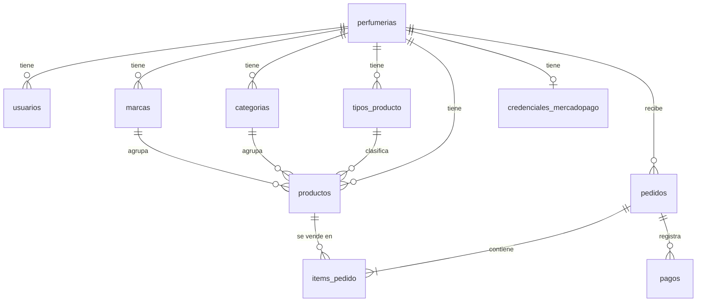

# Modelo de datos

Modelo relacional del MVP (MySQL 8). Las decisiones que lo justifican están en docs/decisiones.md (D-007 a D-009, D-013 a D-018).

## Diagrama



- Toda tabla salvo `perfumerias` tiene `perfumeria_id` (regla multi-tenant).
- El género es un enum, no una tabla (D-008). No hay tabla de roles: un solo rol en el MVP.
- No hay tabla de carrito: el carrito vive en el navegador y el backend recalcula todo al crear el pedido (D-016).
- No hay tabla de clientes: se compra sin cuenta y los datos del comprador quedan en el pedido.

## Convenciones (D-015)
- PK `id BIGINT AUTO_INCREMENT` en todas las tablas.
- `creado_en` y `actualizado_en` (`DATETIME`, con default de la base para que los scripts de carga no tengan que completarlos).
- InnoDB, `utf8mb4`, collation `utf8mb4_0900_ai_ci`: búsquedas y unicidad sin distinguir tildes ni mayúsculas.
- Enums como `VARCHAR` + `CHECK`, mapeados en JPA con `@Enumerated(EnumType.STRING)`.
- Dinero en `DECIMAL(12,2)`.
- Todas las FK con `ON DELETE RESTRICT`.
- Nombres de restricciones: `pk_`, `fk_`, `uk_`, `ck_`, `idx_`.

## Tablas

### perfumerias
| Columna | Tipo | Restricciones |
|---|---|---|
| id | BIGINT | PK |
| slug | VARCHAR(60) | NOT NULL, UNIQUE |
| nombre | VARCHAR(100) | NOT NULL |
| descripcion | VARCHAR(1000) | |
| logo_url | VARCHAR(500) | |
| logo_id | VARCHAR(255) | identificador en Cloudinary (D-003) |
| color_principal | CHAR(7) | formato `#RRGGBB` (validado en la app) |
| whatsapp | VARCHAR(20) | solo dígitos con código de país, ej. `5491122334455` |
| instagram | VARCHAR(50) | solo el usuario, sin `@` ni URL |
| direccion | VARCHAR(255) | |
| email_contacto | VARCHAR(150) | |
| comportamiento_sin_stock | VARCHAR(20) | NOT NULL, default `DESHABILITAR_BOTON`, CHECK (`DESHABILITAR_BOTON`, `MOSTRAR_BOTON`) |
| seo_titulo | VARCHAR(70) | si es NULL se usa el nombre |
| seo_descripcion | VARCHAR(160) | si es NULL se usa la descripción |
| activa | BOOLEAN | NOT NULL, default TRUE |

`comportamiento_sin_stock`:
- `DESHABILITAR_BOTON` (default): el botón de WhatsApp se muestra deshabilitado junto a "Sin stock". Las consultas se concentran en productos que se pueden vender.
- `MOSTRAR_BOTON`: el botón sigue activo y el mensaje pregunta por la reposición.

### usuarios
| Columna | Tipo | Restricciones |
|---|---|---|
| id | BIGINT | PK |
| perfumeria_id | BIGINT | NOT NULL, FK → perfumerias |
| email | VARCHAR(150) | NOT NULL, UNIQUE global (el login no recibe slug) |
| password_hash | VARCHAR(100) | NOT NULL, BCrypt |
| nombre | VARCHAR(100) | NOT NULL |
| rol | VARCHAR(20) | NOT NULL, default `ADMIN`, CHECK (`ADMIN`) |
| activo | BOOLEAN | NOT NULL, default TRUE |

### marcas
| Columna | Tipo | Restricciones |
|---|---|---|
| id | BIGINT | PK |
| perfumeria_id | BIGINT | NOT NULL, FK → perfumerias |
| nombre | VARCHAR(80) | NOT NULL, UNIQUE (perfumeria_id, nombre) |

### categorias
| Columna | Tipo | Restricciones |
|---|---|---|
| id | BIGINT | PK |
| perfumeria_id | BIGINT | NOT NULL, FK → perfumerias |
| nombre | VARCHAR(80) | NOT NULL, UNIQUE (perfumeria_id, nombre) |
| slug | VARCHAR(90) | NOT NULL, UNIQUE (perfumeria_id, slug) |
| descripcion | VARCHAR(500) | texto para la meta description de la página de categoría |

### tipos_producto
| Columna | Tipo | Restricciones |
|---|---|---|
| id | BIGINT | PK |
| perfumeria_id | BIGINT | NOT NULL, FK → perfumerias |
| nombre | VARCHAR(50) | NOT NULL, UNIQUE (perfumeria_id, nombre) |

### productos
| Columna | Tipo | Restricciones |
|---|---|---|
| id | BIGINT | PK |
| perfumeria_id | BIGINT | NOT NULL, FK → perfumerias |
| marca_id | BIGINT | NOT NULL, FK → marcas |
| categoria_id | BIGINT | NOT NULL, FK → categorias |
| tipo_producto_id | BIGINT | NOT NULL, FK → tipos_producto |
| nombre | VARCHAR(150) | NOT NULL |
| slug | VARCHAR(180) | NOT NULL, UNIQUE (perfumeria_id, slug) |
| genero | VARCHAR(10) | NOT NULL, CHECK (`HOMBRE`, `MUJER`, `UNISEX`) |
| mililitros | SMALLINT UNSIGNED | NOT NULL, CHECK > 0 |
| precio | DECIMAL(12,2) | NOT NULL, CHECK >= 0 |
| descripcion | VARCHAR(2000) | |
| notas_salida | VARCHAR(255) | texto libre |
| notas_corazon | VARCHAR(255) | texto libre |
| notas_fondo | VARCHAR(255) | texto libre |
| imagen_url | VARCHAR(500) | |
| imagen_id | VARCHAR(255) | identificador en Cloudinary (D-003) |
| stock | INT UNSIGNED | NOT NULL, default 0 (D-017) |
| activo | BOOLEAN | NOT NULL, default TRUE |

- "Sin stock" es `stock = 0`: se calcula, no se guarda en otra columna.
- Índice `idx_productos_listado (perfumeria_id, activo, categoria_id)` para el listado público. No se agregan más índices hasta medir que hagan falta.

### credenciales_mercadopago
Una fila por perfumería que cobra online (D-018). Si no existe o `activo = false`, el catálogo no muestra el pago con Mercado Pago.

| Columna | Tipo | Restricciones |
|---|---|---|
| id | BIGINT | PK |
| perfumeria_id | BIGINT | NOT NULL, UNIQUE, FK → perfumerias |
| access_token_cifrado | VARCHAR(512) | NOT NULL, AES-GCM en Base64 |
| webhook_secret_cifrado | VARCHAR(512) | NOT NULL, AES-GCM en Base64 |
| modo | VARCHAR(10) | NOT NULL, CHECK (`PRUEBA`, `PRODUCCION`) |
| activo | BOOLEAN | NOT NULL, default FALSE |

- Es una tabla aparte, no columnas de `perfumerias`, para que los secretos nunca viajen en la entidad que se mapea a los DTOs públicos.
- La API nunca devuelve los valores, ni cifrados: solo "configurado sí/no" y el modo.

### pedidos
| Columna | Tipo | Restricciones |
|---|---|---|
| id | BIGINT | PK |
| perfumeria_id | BIGINT | NOT NULL, FK → perfumerias |
| codigo | CHAR(10) | NOT NULL, UNIQUE. Aleatorio y no secuencial; es el `external_reference` en Mercado Pago |
| estado | VARCHAR(20) | NOT NULL, default `PENDIENTE_PAGO`, CHECK (ver estados) |
| comprador_nombre | VARCHAR(100) | NOT NULL |
| comprador_email | VARCHAR(150) | NOT NULL |
| comprador_telefono | VARCHAR(20) | NOT NULL |
| tipo_entrega | VARCHAR(10) | NOT NULL, CHECK (`RETIRO`, `ENVIO`) |
| direccion_entrega | VARCHAR(255) | obligatoria si `tipo_entrega = ENVIO` (se valida en la app) |
| total | DECIMAL(12,2) | NOT NULL, CHECK >= 0. Solo productos: el envío se coordina aparte |
| mp_preferencia_id | VARCHAR(100) | preferencia de Checkout Pro |
| vence_en | DATETIME | NOT NULL. Creación + 30 minutos |
| pagado_en | DATETIME | |

Índice `idx_pedidos_panel (perfumeria_id, estado, creado_en)` para el listado del panel.

#### Estados del pedido
```
PENDIENTE_PAGO ──pago aprobado y stock suficiente──▶ PAGADO ──admin──▶ ENTREGADO
      │                         │
      │                         └─pago aprobado sin stock o con monto distinto─▶ REQUIERE_REVISION
      ├──pasan 30 min sin pago──▶ VENCIDO
      └──admin cancela──────────▶ CANCELADO

PAGADO / REQUIERE_REVISION ──reembolso o contracargo──▶ REEMBOLSADO
REQUIERE_REVISION ──admin resolvió (consiguió el producto)──▶ PAGADO
```
- Un pago rechazado **no** cambia el estado: el comprador puede reintentar hasta que vence.
- Un pago aprobado que llega con el pedido `VENCIDO` sigue el mismo camino que si estuviera `PENDIENTE_PAGO`: descuenta stock y queda `PAGADO`, o queda `REQUIERE_REVISION`.
- Al pasar a `REEMBOLSADO` no se devuelve stock automáticamente: el producto pudo haberse entregado. El admin lo ajusta a mano.

### items_pedido
| Columna | Tipo | Restricciones |
|---|---|---|
| id | BIGINT | PK |
| perfumeria_id | BIGINT | NOT NULL, FK → perfumerias |
| pedido_id | BIGINT | NOT NULL, FK → pedidos |
| producto_id | BIGINT | NOT NULL, FK → productos |
| nombre_producto | VARCHAR(150) | NOT NULL, copia al momento de comprar |
| mililitros | SMALLINT UNSIGNED | NOT NULL, copia |
| precio_unitario | DECIMAL(12,2) | NOT NULL, CHECK >= 0, copia del precio al momento de comprar |
| cantidad | SMALLINT UNSIGNED | NOT NULL, CHECK > 0 |

- `UNIQUE (pedido_id, producto_id)`: un producto aparece una sola vez por pedido, con su cantidad.
- Las copias hacen que el pedido muestre lo que se cobró aunque después cambien el precio o el nombre del producto.

### pagos
Un pedido puede tener varios pagos (por ejemplo, uno rechazado y después uno aprobado).

| Columna | Tipo | Restricciones |
|---|---|---|
| id | BIGINT | PK |
| perfumeria_id | BIGINT | NOT NULL, FK → perfumerias |
| pedido_id | BIGINT | NOT NULL, FK → pedidos |
| mp_pago_id | VARCHAR(30) | NOT NULL, UNIQUE: base de la idempotencia del webhook |
| estado | VARCHAR(20) | NOT NULL, CHECK (`PENDIENTE`, `EN_PROCESO`, `APROBADO`, `RECHAZADO`, `CANCELADO`, `REEMBOLSADO`, `CONTRACARGO`, `EN_MEDIACION`) |
| estado_detalle | VARCHAR(100) | `status_detail` de Mercado Pago |
| monto | DECIMAL(12,2) | NOT NULL |
| medio_pago | VARCHAR(50) | |
| aprobado_en | DATETIME | |

El estado se traduce desde el `status` de Mercado Pago (`approved` → `APROBADO`, `rejected` → `RECHAZADO`, `charged_back` → `CONTRACARGO`, etc.).

## Flujo del pago y descuento de stock (D-016, D-017)
1. **Crear pedido** (`POST /api/publico/{slug}/pedidos`): el frontend manda solo `productoId` + `cantidad` y los datos del comprador. El backend busca cada producto en esa perfumería (activo), toma el precio de la base, verifica `stock >= cantidad`, calcula el total y crea el pedido `PENDIENTE_PAGO`. **No toca el stock.**
2. **Preferencia**: se crea en Mercado Pago con el token de la perfumería, `external_reference = codigo`, vencimiento = `vence_en`, sin medios de pago en efectivo, y la `notification_url` del webhook. Se devuelve el `init_point` y el navegador redirige a Mercado Pago.
3. **Webhook** (`POST /api/publico/webhooks/mercadopago/{perfumeriaId}`):
   1. Se valida la firma (`x-signature`) con el `webhook_secret` de esa perfumería. Si es inválida → 401 y no se procesa.
   2. Se consulta el pago a la API de Mercado Pago con el token de esa perfumería. Nunca se usan datos del body.
   3. Se busca el pedido por `codigo` (`external_reference`) **y** `perfumeria_id`.
   4. Upsert en `pagos` por `mp_pago_id`.
   5. Si el pago está `APROBADO`, en una transacción con el pedido bloqueado (`SELECT … FOR UPDATE`) y solo si el pedido está en `PENDIENTE_PAGO` o `VENCIDO`:
      - si `monto ≠ total` → `REQUIERE_REVISION`;
      - se bloquean los productos del pedido (`SELECT … FOR UPDATE`) y se verifica que alcance el stock de **todos**. Si alguno no alcanza → `REQUIERE_REVISION` sin descontar nada;
      - si alcanza, por cada item: `UPDATE productos SET stock = stock - :cantidad WHERE id = :id AND stock >= :cantidad` (la condición es una segunda barrera contra el stock negativo) → `PAGADO` y `pagado_en`.
   6. Responde 200. Si el mismo webhook llega otra vez, el pedido ya no está en `PENDIENTE_PAGO` y no se procesa de nuevo.
4. **Página de retorno** (`/{slug}/pedido/{codigo}`): solo **muestra** el estado consultando el backend. No confirma nada. Muestra estado, items y total, nunca los datos personales del comprador.
5. **Vencimiento**: una tarea `@Scheduled` (incluida en Spring, sin dependencias) pasa a `VENCIDO` los pedidos `PENDIENTE_PAGO` con `vence_en` cumplido.

## Reglas que se validan en la aplicación
La base no puede garantizar todo; estas reglas viven en los services (con tests) y en Bean Validation:
- **Aislamiento de relaciones (D-013)**: al crear o editar un producto, marca, categoría y tipo se buscan con `findByIdAndPerfumeriaId`. Si no pertenecen a la perfumería del usuario → 404. Lo mismo para los productos de un pedido: se buscan en la perfumería del slug.
- **Slugs (D-014)**: generados por el backend, únicos por perfumería, fijos después de crearse. Slugs de perfumería reservados: `admin`, `api`.
- **Formatos**: `color_principal` (`#RRGGBB`), `whatsapp` y `comprador_telefono` (solo dígitos), emails válidos, longitudes máximas iguales a las de la tabla.
- **Eliminación (D-009)**: marca, categoría o tipo con productos → 409; producto con pedidos → 409 (se oculta con `activo = false`). Siempre antes de llegar al `RESTRICT` de la base.
- **Precios y totales**: siempre desde la base, nunca desde el request (regla de pagos en CLAUDE.md).
- **Transiciones de estado**: solo las del diagrama. Una transición inválida → 409.

## SQL inicial
Será la migración `V1__esquema_inicial.sql` de Flyway en la Etapa 4. Las 2 perfumerías de la demo, sus usuarios y sus categorías y tipos iniciales (Perfumes, Decants, Body Splash / EDP, EDT, Extrait de parfum, Body Splash, Decant) van en una migración aparte (D-010).
Las tablas de pedidos, pagos y credenciales van en su propia migración en la Etapa 12 (ver "SQL de pedidos y pagos"): cada etapa agrega su migración y el historial de Flyway muestra cómo creció el esquema.

```sql
CREATE TABLE perfumerias (
    id                       BIGINT        NOT NULL AUTO_INCREMENT,
    slug                     VARCHAR(60)   NOT NULL,
    nombre                   VARCHAR(100)  NOT NULL,
    descripcion              VARCHAR(1000) NULL,
    logo_url                 VARCHAR(500)  NULL,
    logo_id                  VARCHAR(255)  NULL,
    color_principal          CHAR(7)       NULL,
    whatsapp                 VARCHAR(20)   NULL,
    instagram                VARCHAR(50)   NULL,
    direccion                VARCHAR(255)  NULL,
    email_contacto           VARCHAR(150)  NULL,
    comportamiento_sin_stock VARCHAR(20)   NOT NULL DEFAULT 'DESHABILITAR_BOTON',
    seo_titulo               VARCHAR(70)   NULL,
    seo_descripcion          VARCHAR(160)  NULL,
    activa                   BOOLEAN       NOT NULL DEFAULT TRUE,
    creado_en                DATETIME      NOT NULL DEFAULT CURRENT_TIMESTAMP,
    actualizado_en           DATETIME      NOT NULL DEFAULT CURRENT_TIMESTAMP ON UPDATE CURRENT_TIMESTAMP,
    CONSTRAINT pk_perfumerias PRIMARY KEY (id),
    CONSTRAINT uk_perfumerias_slug UNIQUE (slug),
    CONSTRAINT ck_perfumerias_sin_stock CHECK (comportamiento_sin_stock IN ('DESHABILITAR_BOTON', 'MOSTRAR_BOTON'))
) ENGINE = InnoDB DEFAULT CHARSET = utf8mb4 COLLATE = utf8mb4_0900_ai_ci;

CREATE TABLE usuarios (
    id             BIGINT       NOT NULL AUTO_INCREMENT,
    perfumeria_id  BIGINT       NOT NULL,
    email          VARCHAR(150) NOT NULL,
    password_hash  VARCHAR(100) NOT NULL,
    nombre         VARCHAR(100) NOT NULL,
    rol            VARCHAR(20)  NOT NULL DEFAULT 'ADMIN',
    activo         BOOLEAN      NOT NULL DEFAULT TRUE,
    creado_en      DATETIME     NOT NULL DEFAULT CURRENT_TIMESTAMP,
    actualizado_en DATETIME     NOT NULL DEFAULT CURRENT_TIMESTAMP ON UPDATE CURRENT_TIMESTAMP,
    CONSTRAINT pk_usuarios PRIMARY KEY (id),
    CONSTRAINT uk_usuarios_email UNIQUE (email),
    CONSTRAINT fk_usuarios_perfumeria FOREIGN KEY (perfumeria_id) REFERENCES perfumerias (id) ON DELETE RESTRICT,
    CONSTRAINT ck_usuarios_rol CHECK (rol IN ('ADMIN'))
) ENGINE = InnoDB DEFAULT CHARSET = utf8mb4 COLLATE = utf8mb4_0900_ai_ci;

CREATE TABLE marcas (
    id             BIGINT      NOT NULL AUTO_INCREMENT,
    perfumeria_id  BIGINT      NOT NULL,
    nombre         VARCHAR(80) NOT NULL,
    creado_en      DATETIME    NOT NULL DEFAULT CURRENT_TIMESTAMP,
    actualizado_en DATETIME    NOT NULL DEFAULT CURRENT_TIMESTAMP ON UPDATE CURRENT_TIMESTAMP,
    CONSTRAINT pk_marcas PRIMARY KEY (id),
    CONSTRAINT uk_marcas_perfumeria_nombre UNIQUE (perfumeria_id, nombre),
    CONSTRAINT fk_marcas_perfumeria FOREIGN KEY (perfumeria_id) REFERENCES perfumerias (id) ON DELETE RESTRICT
) ENGINE = InnoDB DEFAULT CHARSET = utf8mb4 COLLATE = utf8mb4_0900_ai_ci;

CREATE TABLE categorias (
    id             BIGINT       NOT NULL AUTO_INCREMENT,
    perfumeria_id  BIGINT       NOT NULL,
    nombre         VARCHAR(80)  NOT NULL,
    slug           VARCHAR(90)  NOT NULL,
    descripcion    VARCHAR(500) NULL,
    creado_en      DATETIME     NOT NULL DEFAULT CURRENT_TIMESTAMP,
    actualizado_en DATETIME     NOT NULL DEFAULT CURRENT_TIMESTAMP ON UPDATE CURRENT_TIMESTAMP,
    CONSTRAINT pk_categorias PRIMARY KEY (id),
    CONSTRAINT uk_categorias_perfumeria_nombre UNIQUE (perfumeria_id, nombre),
    CONSTRAINT uk_categorias_perfumeria_slug UNIQUE (perfumeria_id, slug),
    CONSTRAINT fk_categorias_perfumeria FOREIGN KEY (perfumeria_id) REFERENCES perfumerias (id) ON DELETE RESTRICT
) ENGINE = InnoDB DEFAULT CHARSET = utf8mb4 COLLATE = utf8mb4_0900_ai_ci;

CREATE TABLE tipos_producto (
    id             BIGINT      NOT NULL AUTO_INCREMENT,
    perfumeria_id  BIGINT      NOT NULL,
    nombre         VARCHAR(50) NOT NULL,
    creado_en      DATETIME    NOT NULL DEFAULT CURRENT_TIMESTAMP,
    actualizado_en DATETIME    NOT NULL DEFAULT CURRENT_TIMESTAMP ON UPDATE CURRENT_TIMESTAMP,
    CONSTRAINT pk_tipos_producto PRIMARY KEY (id),
    CONSTRAINT uk_tipos_producto_perfumeria_nombre UNIQUE (perfumeria_id, nombre),
    CONSTRAINT fk_tipos_producto_perfumeria FOREIGN KEY (perfumeria_id) REFERENCES perfumerias (id) ON DELETE RESTRICT
) ENGINE = InnoDB DEFAULT CHARSET = utf8mb4 COLLATE = utf8mb4_0900_ai_ci;

CREATE TABLE productos (
    id               BIGINT            NOT NULL AUTO_INCREMENT,
    perfumeria_id    BIGINT            NOT NULL,
    marca_id         BIGINT            NOT NULL,
    categoria_id     BIGINT            NOT NULL,
    tipo_producto_id BIGINT            NOT NULL,
    nombre           VARCHAR(150)      NOT NULL,
    slug             VARCHAR(180)      NOT NULL,
    genero           VARCHAR(10)       NOT NULL,
    mililitros       SMALLINT UNSIGNED NOT NULL,
    precio           DECIMAL(12, 2)    NOT NULL,
    descripcion      VARCHAR(2000)     NULL,
    notas_salida     VARCHAR(255)      NULL,
    notas_corazon    VARCHAR(255)      NULL,
    notas_fondo      VARCHAR(255)      NULL,
    imagen_url       VARCHAR(500)      NULL,
    imagen_id        VARCHAR(255)      NULL,
    stock            INT UNSIGNED      NOT NULL DEFAULT 0,
    activo           BOOLEAN           NOT NULL DEFAULT TRUE,
    creado_en        DATETIME          NOT NULL DEFAULT CURRENT_TIMESTAMP,
    actualizado_en   DATETIME          NOT NULL DEFAULT CURRENT_TIMESTAMP ON UPDATE CURRENT_TIMESTAMP,
    CONSTRAINT pk_productos PRIMARY KEY (id),
    CONSTRAINT uk_productos_perfumeria_slug UNIQUE (perfumeria_id, slug),
    CONSTRAINT fk_productos_perfumeria FOREIGN KEY (perfumeria_id) REFERENCES perfumerias (id) ON DELETE RESTRICT,
    CONSTRAINT fk_productos_marca FOREIGN KEY (marca_id) REFERENCES marcas (id) ON DELETE RESTRICT,
    CONSTRAINT fk_productos_categoria FOREIGN KEY (categoria_id) REFERENCES categorias (id) ON DELETE RESTRICT,
    CONSTRAINT fk_productos_tipo_producto FOREIGN KEY (tipo_producto_id) REFERENCES tipos_producto (id) ON DELETE RESTRICT,
    CONSTRAINT ck_productos_genero CHECK (genero IN ('HOMBRE', 'MUJER', 'UNISEX')),
    CONSTRAINT ck_productos_mililitros CHECK (mililitros > 0),
    CONSTRAINT ck_productos_precio CHECK (precio >= 0)
) ENGINE = InnoDB DEFAULT CHARSET = utf8mb4 COLLATE = utf8mb4_0900_ai_ci;

CREATE INDEX idx_productos_listado ON productos (perfumeria_id, activo, categoria_id);
```

## SQL de pedidos y pagos
Migración propia en la Etapa 12.

```sql
CREATE TABLE credenciales_mercadopago (
    id                     BIGINT       NOT NULL AUTO_INCREMENT,
    perfumeria_id          BIGINT       NOT NULL,
    access_token_cifrado   VARCHAR(512) NOT NULL,
    webhook_secret_cifrado VARCHAR(512) NOT NULL,
    modo                   VARCHAR(10)  NOT NULL,
    activo                 BOOLEAN      NOT NULL DEFAULT FALSE,
    creado_en              DATETIME     NOT NULL DEFAULT CURRENT_TIMESTAMP,
    actualizado_en         DATETIME     NOT NULL DEFAULT CURRENT_TIMESTAMP ON UPDATE CURRENT_TIMESTAMP,
    CONSTRAINT pk_credenciales_mercadopago PRIMARY KEY (id),
    CONSTRAINT uk_credenciales_mercadopago_perfumeria UNIQUE (perfumeria_id),
    CONSTRAINT fk_credenciales_mercadopago_perfumeria FOREIGN KEY (perfumeria_id) REFERENCES perfumerias (id) ON DELETE RESTRICT,
    CONSTRAINT ck_credenciales_mercadopago_modo CHECK (modo IN ('PRUEBA', 'PRODUCCION'))
) ENGINE = InnoDB DEFAULT CHARSET = utf8mb4 COLLATE = utf8mb4_0900_ai_ci;

CREATE TABLE pedidos (
    id                 BIGINT         NOT NULL AUTO_INCREMENT,
    perfumeria_id      BIGINT         NOT NULL,
    codigo             CHAR(10)       NOT NULL,
    estado             VARCHAR(20)    NOT NULL DEFAULT 'PENDIENTE_PAGO',
    comprador_nombre   VARCHAR(100)   NOT NULL,
    comprador_email    VARCHAR(150)   NOT NULL,
    comprador_telefono VARCHAR(20)    NOT NULL,
    tipo_entrega       VARCHAR(10)    NOT NULL,
    direccion_entrega  VARCHAR(255)   NULL,
    total              DECIMAL(12, 2) NOT NULL,
    mp_preferencia_id  VARCHAR(100)   NULL,
    vence_en           DATETIME       NOT NULL,
    pagado_en          DATETIME       NULL,
    creado_en          DATETIME       NOT NULL DEFAULT CURRENT_TIMESTAMP,
    actualizado_en     DATETIME       NOT NULL DEFAULT CURRENT_TIMESTAMP ON UPDATE CURRENT_TIMESTAMP,
    CONSTRAINT pk_pedidos PRIMARY KEY (id),
    CONSTRAINT uk_pedidos_codigo UNIQUE (codigo),
    CONSTRAINT fk_pedidos_perfumeria FOREIGN KEY (perfumeria_id) REFERENCES perfumerias (id) ON DELETE RESTRICT,
    CONSTRAINT ck_pedidos_estado CHECK (estado IN ('PENDIENTE_PAGO', 'PAGADO', 'REQUIERE_REVISION', 'ENTREGADO', 'VENCIDO', 'CANCELADO', 'REEMBOLSADO')),
    CONSTRAINT ck_pedidos_tipo_entrega CHECK (tipo_entrega IN ('RETIRO', 'ENVIO')),
    CONSTRAINT ck_pedidos_total CHECK (total >= 0)
) ENGINE = InnoDB DEFAULT CHARSET = utf8mb4 COLLATE = utf8mb4_0900_ai_ci;

CREATE INDEX idx_pedidos_panel ON pedidos (perfumeria_id, estado, creado_en);

CREATE TABLE items_pedido (
    id              BIGINT            NOT NULL AUTO_INCREMENT,
    perfumeria_id   BIGINT            NOT NULL,
    pedido_id       BIGINT            NOT NULL,
    producto_id     BIGINT            NOT NULL,
    nombre_producto VARCHAR(150)      NOT NULL,
    mililitros      SMALLINT UNSIGNED NOT NULL,
    precio_unitario DECIMAL(12, 2)    NOT NULL,
    cantidad        SMALLINT UNSIGNED NOT NULL,
    creado_en       DATETIME          NOT NULL DEFAULT CURRENT_TIMESTAMP,
    actualizado_en  DATETIME          NOT NULL DEFAULT CURRENT_TIMESTAMP ON UPDATE CURRENT_TIMESTAMP,
    CONSTRAINT pk_items_pedido PRIMARY KEY (id),
    CONSTRAINT uk_items_pedido_pedido_producto UNIQUE (pedido_id, producto_id),
    CONSTRAINT fk_items_pedido_perfumeria FOREIGN KEY (perfumeria_id) REFERENCES perfumerias (id) ON DELETE RESTRICT,
    CONSTRAINT fk_items_pedido_pedido FOREIGN KEY (pedido_id) REFERENCES pedidos (id) ON DELETE RESTRICT,
    CONSTRAINT fk_items_pedido_producto FOREIGN KEY (producto_id) REFERENCES productos (id) ON DELETE RESTRICT,
    CONSTRAINT ck_items_pedido_precio CHECK (precio_unitario >= 0),
    CONSTRAINT ck_items_pedido_cantidad CHECK (cantidad > 0)
) ENGINE = InnoDB DEFAULT CHARSET = utf8mb4 COLLATE = utf8mb4_0900_ai_ci;

CREATE TABLE pagos (
    id             BIGINT         NOT NULL AUTO_INCREMENT,
    perfumeria_id  BIGINT         NOT NULL,
    pedido_id      BIGINT         NOT NULL,
    mp_pago_id     VARCHAR(30)    NOT NULL,
    estado         VARCHAR(20)    NOT NULL,
    estado_detalle VARCHAR(100)   NULL,
    monto          DECIMAL(12, 2) NOT NULL,
    medio_pago     VARCHAR(50)    NULL,
    aprobado_en    DATETIME       NULL,
    creado_en      DATETIME       NOT NULL DEFAULT CURRENT_TIMESTAMP,
    actualizado_en DATETIME       NOT NULL DEFAULT CURRENT_TIMESTAMP ON UPDATE CURRENT_TIMESTAMP,
    CONSTRAINT pk_pagos PRIMARY KEY (id),
    CONSTRAINT uk_pagos_mp_pago_id UNIQUE (mp_pago_id),
    CONSTRAINT fk_pagos_perfumeria FOREIGN KEY (perfumeria_id) REFERENCES perfumerias (id) ON DELETE RESTRICT,
    CONSTRAINT fk_pagos_pedido FOREIGN KEY (pedido_id) REFERENCES pedidos (id) ON DELETE RESTRICT,
    CONSTRAINT ck_pagos_estado CHECK (estado IN ('PENDIENTE', 'EN_PROCESO', 'APROBADO', 'RECHAZADO', 'CANCELADO', 'REEMBOLSADO', 'CONTRACARGO', 'EN_MEDIACION'))
) ENGINE = InnoDB DEFAULT CHARSET = utf8mb4 COLLATE = utf8mb4_0900_ai_ci;
```

## Fuera del modelo en el MVP
Variantes de un perfume (D-007), notas olfativas normalizadas, varias imágenes por producto, más roles, horarios y dominios propios. Cuentas de cliente, costo de envío calculado, reserva de stock al crear el pedido (D-017), pedidos de WhatsApp guardados en la base (D-016) y conexión con Mercado Pago por OAuth (D-018). Ver "Segunda versión" en docs/roadmap.md.
